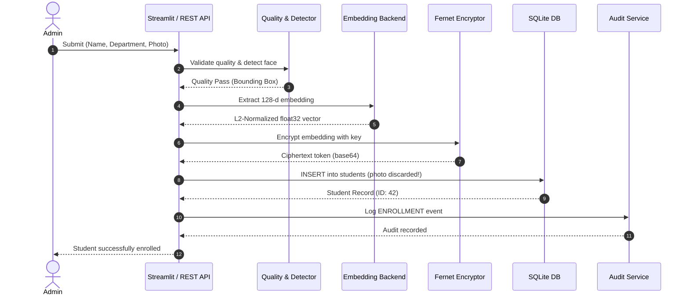
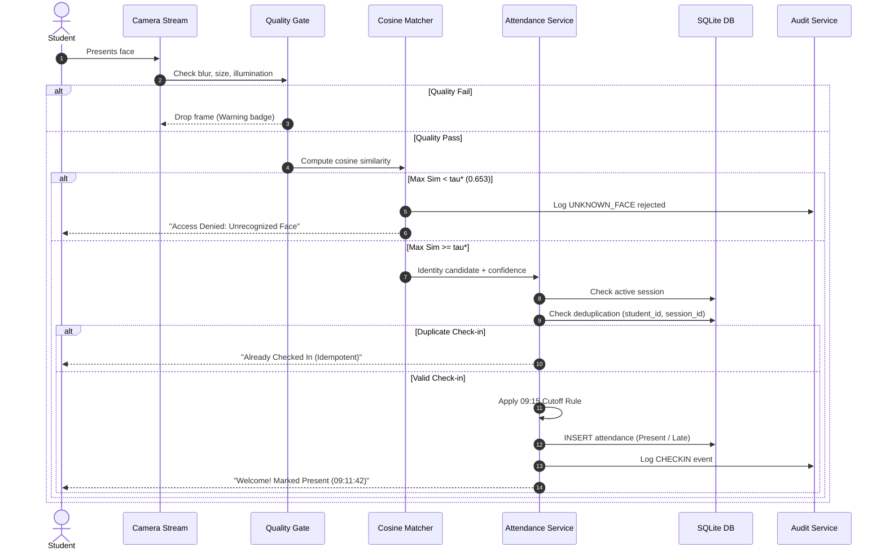
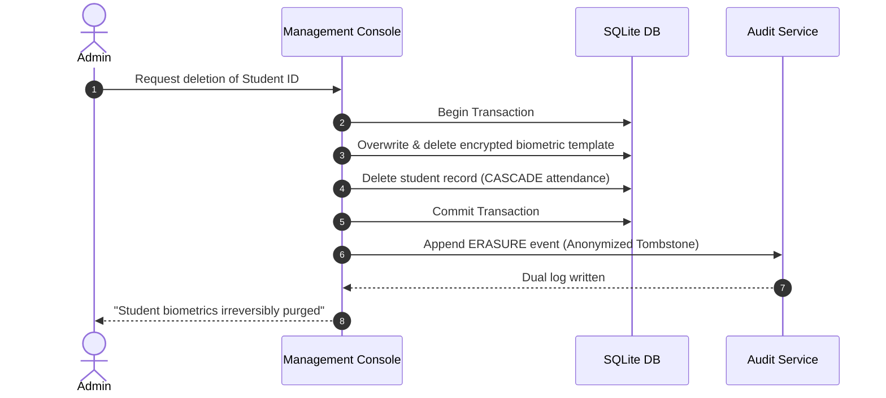

# System Architecture Specification

## 1. Overview & Architectural Principles

The **Face Recognition Attendance System (FRAS)** is an enterprise biometric solution engineered to solve institutional attendance logging through computer vision while strictly adhering to privacy regulations (GDPR Art. 9/17, FERPA).

### Key Architectural Principles
1. **Decoupled Biometric Engine**: The biometric embedding backend implements a strict Python `Protocol` interface (`EmbeddingBackend`). Recognition models can be swapped (e.g. from synthetic avatar ResNet to real-face SFace or InsightFace) with zero modification to attendance business rules or database logic.
2. **Biometric Privacy by Design**: Raw photographic images are never retained. Images are converted into normalized embeddings in volatile memory and immediately discarded. Biometric embeddings are encrypted at rest with Fernet (AES-128-CBC + HMAC-SHA256).
3. **Threshold Calibration Hygiene**: The decision boundary ($\tau^* = 0.653$) is calibrated exclusively on validation split impostor distributions to guarantee an operational False Acceptance Rate $\text{FAR} \le 1.0\%$. The threshold is never fitted on test data.
4. **Idempotency & Business Rule Integrity**: Attendance events are guarded by compound unique keys `(student_id, session_id)` ensuring duplicate check-ins within the same session are structurally rejected.
5. **Multi-Channel Auditability**: High-impact actions (enrollment, check-in, manual status override, biometric deletion) are written simultaneously to the relational database and an append-only JSONL log file.

---

## 2. Layered Pipeline Architecture

```
┌─────────────────────────────────────────────────────────────┐
│ 1. INPUT LAYER: Camera Stream / Video Feed / Static Image   │
└──────────────────────────────┬──────────────────────────────┘
                               │
                               ▼
┌─────────────────────────────────────────────────────────────┐
│ 2. QUALITY GATES: Blur, Face Geometry, Luminance Analysis   │
└──────────────────────────────┬──────────────────────────────┘
                               │
                               ▼
┌─────────────────────────────────────────────────────────────┐
│ 3. DETECTION & ALIGNMENT: YuNet / 5-Point Affine Similarity │
└──────────────────────────────┬──────────────────────────────┘
                               │
                               ▼
┌─────────────────────────────────────────────────────────────┐
│ 4. EMBEDDING ENGINE: Protocol-swappable ArcFace / SFace     │
└──────────────────────────────┬──────────────────────────────┘
                               │
                               ▼
┌─────────────────────────────────────────────────────────────┐
│ 5. MATCHING & LIVENESS: Cosine Search, tau*, Motion Yaw     │
└──────────────────────────────┬──────────────────────────────┘
                               │
                               ▼
┌─────────────────────────────────────────────────────────────┐
│ 6. DECISION ENGINE: Temporal Consensus (k-of-n frames)      │
└──────────────────────────────┬──────────────────────────────┘
                               │
                               ▼
┌─────────────────────────────────────────────────────────────┐
│ 7. ATTENDANCE SERVICE: Session Gate, 09:15 Cutoff, Dedupe   │
└──────────────────────────────┬──────────────────────────────┘
                               │
                               ▼
┌─────────────────────────────────────────────────────────────┐
│ 8. PERSISTENCE & AUDIT: Encrypted SQLite, JSONL Trail       │
└──────────────────────────────┬──────────────────────────────┘
                               │
                               ▼
┌─────────────────────────────────────────────────────────────┐
│ 9. PRESENTATION LAYER: FastAPI (REST) & Streamlit Dashboard │
└─────────────────────────────────────────────────────────────┘
```

---

## 3. Component Deep Dive

### 3.1 Quality Gates (`fras.core.quality`)
Before computational resources are spent on inference, frames pass through three lightweight filters:
- **Laplacian Variance Blur Gate**: Computes $\sigma^2(\nabla^2 I)$. Rejects frames with variance $< 50.0$ to eliminate motion blur.
- **Minimum Face Geometry**: Rejects bounding boxes smaller than $60 \times 60$ pixels to ensure adequate resolution for feature extraction.
- **Luminance Gate**: Computes mean grayscale intensity $\mu_Y$. Rejects frames where $\mu_Y < 40$ (underexposed/dark) or $\mu_Y > 220$ (overexposed/blown-out).

### 3.2 Multi-Backend Architecture (`fras.recognition`)
FRAS implements a two-backend architecture via the `EmbeddingBackend` protocol:

```python
class EmbeddingBackend(Protocol):
    @property
    def name(self) -> str: ...
    @property
    def embedding_dim(self) -> int: ...
    def embed(self, batch_images: np.ndarray) -> np.ndarray: ...
    def preprocess(self, image_rgb: np.ndarray) -> np.ndarray: ...
```

1. **`avatar_cnn` (In-House ONNX)**:
   - Trained on the CC0 synthetic cartoon avatar dataset.
   - Backbone: Compact `AvatarResNet` with residual blocks, global average pooling, and 128-d linear projection.
   - Objective: ArcFace additive angular margin loss ($s=32.0, m=0.5$).
   - Performance: $p_{50} = 3.55\text{ ms}$ on single-thread CPU; powers reproducible synthetic benchmarks and demo kiosk.
2. **`sface` (OpenCV Zoo ONNX)**:
   - Backbone: Lightweight MobileFaceNet architecture trained on real human faces.
   - Alignment: 5-point facial landmark similarity transformation using OpenCV `FaceDetectorYN`.
   - Dimension: 128-d L2-normalized embeddings.
   - Use Case: Live webcam operation on real human subjects.

### 3.3 Vector Matching & Decision Engine (`fras.recognition.matcher`)
- **Normalized Vector Search**: Enrolled templates are represented as matrix $G \in \mathbb{R}^{N \times 128}$ with $\|G_i\|_2 = 1$. Probe embedding $p \in \mathbb{R}^{128}$ with $\|p\|_2 = 1$ is matched via dot product:
  $$\mathbf{s} = G p^\top, \quad s_{\max} = \max_i s_i, \quad i^* = \operatorname{argmax}_i s_i$$
- **Open-Set Rejection**: If $s_{\max} < \tau^* = 0.653$, the probe is classified as `UNKNOWN_STRANGER`. The system rejects the transaction and logs the probe event without auto-enrolling.
- **Temporal Voting Consensus**: In continuous camera streams, attendance is only confirmed when the same student identity is matched in at least $k$ out of $n$ consecutive frames (default: 3 out of 5 frames), mitigating single-frame false positives.
- **Active Challenge-Response Liveness**: Prompts user for head orientation changes (`TURN_LEFT`, `TURN_RIGHT`) and measures landmark yaw asymmetry ratio $\frac{|x_{\text{nose}} - x_{\text{re}}|}{|x_{\text{le}} - x_{\text{nose}}|}$ before confirming check-in.

### 3.4 Attendance Business Logic (`fras.attendance.rules`)
- **Active Session Enforcement**: Check-ins are accepted only during an active attendance session created by a faculty member.
- **Punctuality Cutoff**: The official late cutoff is set to `09:15:00` (derived from the historical ground-truth log). Check-ins on or before 09:15:00 are classified as `Present`; check-ins after 09:15:00 are classified as `Late`.
- **Deduplication Constraint**: If an attendance record for `(student_id, session_id)` already exists, subsequent attempts return the existing record with an `already_checked_in` flag and are not duplicated.

---

## 4. Sequence Diagrams

### 4.1 Student Enrollment Workflow



### 4.2 Live Attendance Check-In Workflow



### 4.3 GDPR Right-to-Erasure Workflow



---

## 5. Failure Modes & Graceful Degradation

| Failure Mode | Root Cause | System Response & Mitigation |
| :--- | :--- | :--- |
| **No Physical Webcam** | Headless server, CI, or missing camera | System automatically degrades to simulated avatar video feed (`SimulatedCameraStream`) cycling through dataset probe images. |
| **YuNet / SFace Not Downloaded** | Offline environment, missing weights | System raises clear `FileNotFoundError` with download instructions; `avatar_cnn` backend remains 100% operational. |
| **Poor Environmental Quality** | Severe blur, dark lighting, small face | Frame is dropped at the quality gate with instant visual UI indicators; no corrupted embeddings are generated. |
| **Camera Disconnect** | Hardware failure during active session | Background worker catches stream disconnection, logs warning to audit trail, and offers manual supervisory override. |
| **Database Lock / Contention** | Concurrent writes in SQLite | SQLAlchemy session handles timeout retries; write transactions are short-lived. |

---

## 6. Threat Model & Security Mitigations

1. **Database Breach (Template Extraction)**:
   - *Threat*: Adversary steals the SQLite database file and attempts to reconstruct face images.
   - *Mitigation*: No photographs are stored. Biometric templates are stored as Fernet ciphertext tokens encrypted under an AES-128 key stored outside the database in an environment variable or secrets manager. Even with the raw embeddings, face inversion from a 128-d bottleneck is mathematically non-invertible.
2. **Presentation Attack (Photo Replay)**:
   - *Threat*: Student holds up a printed photograph or smartphone image of an enrolled peer.
   - *Mitigation*: Multi-frame temporal voting requires consistent temporal presence; active challenge-response prompts the user to rotate their head, measuring geometric landmark changes.
3. **Audit Log Tampering**:
   - *Threat*: Compromised user attempts to delete records of unauthorized attendance modifications.
   - *Mitigation*: Dual logging writes records to both the relational database and an append-only `logs/audit.jsonl` file.
